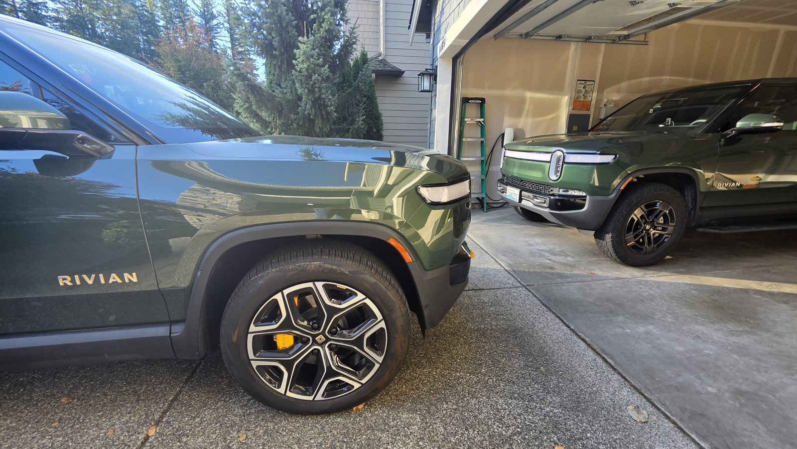
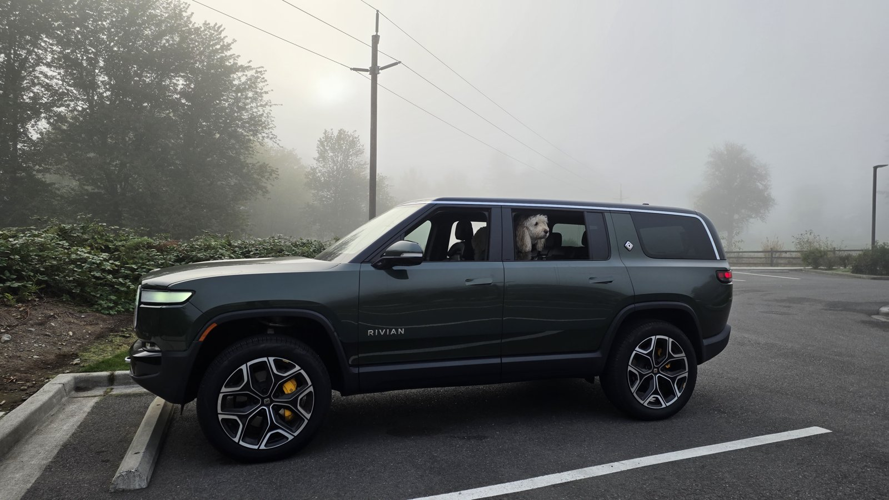
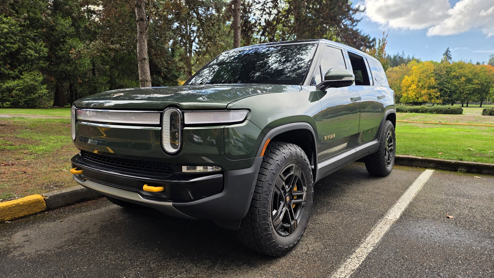

Two Rivians, 60k miles between them, and it took me three tries to buy a third one. This is the full story of buying a used Gen 1 quad R1S through Rivian Direct, from a flight to Colorado Springs that ended with me walking away, to a cancelled Launch Edition, to the Forest Green R1S sitting in my driveway right now. At the end is the delivery day checklist I wish I had taken with me the first time.

*Two Rivians. The R1S here is still on the stock 22 inch Sport Bright wheels it came with.*

## Why I Was Buying Used in the First Place

My R1S lease was ending in September. I had already decided to skip Gen 2 and buy a used Gen 1 quad instead. Someone else already paid the depreciation, and after two and a half years I knew exactly what I needed. I wrote about that decision in [The Best Car I've Ever Owned](https://electricadventurer.com/blog/best-car-ive-ever-owned/) and shared it on r/Rivian ([post](https://www.reddit.com/r/Rivian/s/LpNaT8cmeD), [thread](https://www.reddit.com/r/Rivian/s/9OBRN1VFsd)). Most of those miles came from trips like [A Winter Colorado Electric Adventure in R1S](https://electricadventurer.com/blog/trailspark-seattle-denver-road-trip/).

Side note: while removing my Nexar dash cam before returning the leased R1S, I cracked the windshield. That cost me $1,600 out of pocket. Take your time with dash cam mounts.

I've bought used cars before. A CPO BMW X5 that was meticulously detailed with zero cosmetic issues. A 2013 Infiniti FX37 from an independent used car dealer in 2020. A 2013 CPO Honda Civic from a Honda dealership. None of them had any problems. So I went into Rivian Direct with reasonable expectations.

## Attempt One: Colorado Springs

I found a 2023 R1S Quad Large in Rivian Blue at the Rivian Colorado Springs Service Center. $65,500, 31,877 miles, 20 inch AT Dark wheels, my exact spec. The listing disclosed hail damage that Rivian said was repaired before listing. I put down a $10,000 deposit and flew from Washington to Colorado Springs to take delivery.

The car had a cracked light bar, scratched wheels, paint chips throughout, pitting on the windshield and what looked like hail damage on the glass roof. Rivian's website says their pre-owned vehicles are meticulously inspected. When I raised the issues, I was told Rivian only cares whether the car is drivable. For $65,500, cosmetic condition matters to me.

I declined delivery and flew home without the car.

**I posted the full write-up with photos of the damage on r/Rivian at the time: [here is that thread](https://www.reddit.com/r/Rivian/s/KcSrRM8trD).** If you want to see what I was looking at in that parking lot, that is where the pictures are.

Every other used car I've bought, I could see and drive before committing. Rivian Direct took my money first and showed me the car second. Getting the $10,000 deposit back took about two months and several follow-up calls. I'm still chasing a $250 fee.

## Attempt Two: The Red Canyon Launch Edition

On August 2 I ordered a 2022 Launch Edition R1S in Red Canyon out of Salt Lake City. Rivian later cancelled it because they couldn't source the drive unit. Frustrating, but at least I found out before getting on another plane.

Worth knowing if you are shopping the early cars: a listed pre-owned Rivian can be pulled for parts availability after you have ordered it, and the 2022 and Launch Edition cars carry more of that risk than the later build years.

## Attempt Three: Forest Green From Boise

Next I ordered a 2024 R1S Adventure Quad Large in Forest Green with about 21,500 miles, Black Mountain interior with Dark Ash Wood, out of Boise. It also came with an unopened box of crossbars sitting in the trunk, which was a nice surprise. Since Rivian had cancelled the Red Canyon car, they shipped this one from Boise to Portland for free. Portland was much easier for me to get to, so I drove down and picked it up there.

*Korra approves.*

Right after pickup I had a lot of wheel shake. I opened a service ticket, but before Rivian got to it I swapped the stock 22 inch Sport Bright wheels for a set of Rivian OEM 20 inch AT Dark wheels I had bought from Texas Wheels. The shake went away completely, so I'm fairly sure it was just a wheel balancing issue.

*After the swap, on the 20 inch AT Dark wheels.*

Since then the car has been flawless except for a Highway Assist issue that Rivian is going to look at soon. I've put about 3,000 miles on it already.

The car still had factory warranty left, which after Colorado Springs mattered to me more than the price did.

## What I Know Now

Six things, roughly in the order they cost me money.

**1. A disclosure is not a condition report.** The Colorado Springs listing did disclose hail damage, and said it had been repaired before listing. The word repaired was doing a lot of work. What the listing did not mention was the cracked light bar, the scratched wheels, the paint chips, or the windshield pitting. Read a disclosure as the floor, not the ceiling.

**2. Ask about condition in writing before you put money down.** Name the parts: light bar, paint, glass, roof, wheels, windshield. Ask what repaired means and who did the work. I did not do this in July and would not skip it again.

**3. Know what your deposit actually is.** Mine was $10,000 plus a $250 fee. The $10,000 came back, but it took about two months and several follow-up calls, and I am still chasing the $250. Do not count that money toward the next car, and get the condition-mismatch case in writing rather than assuming non-refundable has an obvious exception.

**4. Early build years carry parts risk, not just a lower price.** The Salt Lake car died on a drive unit nobody could source. 2022 and Launch Edition cars are cheaper for real reasons and one of them is that the supply chain behind them is thinner.

**5. Buy the warranty, not the car.** On a Gen 1 Rivian, remaining factory coverage is most of the risk calculation. Check the in-service date rather than the model year, because that is what the clock runs from.

**6. Do the whole inspection before you sign, not after.** Drive it cold, drive it on a highway, run camp mode and the tire inflator, sit in every seat, and look at the car in daylight on a day you are not excited about it.

## Rivian Care

I bought Rivian Care, which gave me five years of unlimited-mileage coverage for about $2,000. With how many miles I put on these cars, that was an easy call.

Two things about it matter if you are shopping pre-owned. **Eligibility runs out on age and mileage**: the vehicle has to be under 8 years old with fewer than 80,000 miles, registered for personal use and maintained on Rivian's schedule. A 2022 with 60,000 on it is closer to that edge than its price suggests.

And **in this phase it is only open to cars bought from Rivian**, meaning new, through Rivian Pre-Owned, or as the original owner. People who bought from a private seller are expected to get access in 2027 with an inspection. That is the one argument in favour of the channel that cost me a flight to Colorado Springs.

## The Delivery Day Checklist

Walk it in this order. The first four are the ones that caught me.

- [ ] Light bar, straight on and from both ends, looking for cracks and moisture
- [ ] Roof, hood and upper panels in daylight from a low angle, looking for hail dimples
- [ ] All four wheels, inside and outside the barrel, for curb rash
- [ ] Every panel for chips, and the front end specifically for rock strike
- [ ] Glass: windshield, all side glass, and the panoramic roof, for chips, pitting and star cracks
- [ ] Frunk and bed or cargo area, including the floor and the seals
- [ ] Tire date codes and tread depth on all four, plus the spare situation
- [ ] In-service date in the app or on the window sticker, which sets the warranty clock
- [ ] Service history, and ask directly whether it has had any body or paint work
- [ ] Charge port door, both latches, and a real charge session before you leave
- [ ] Every seat, every seatbelt, and the third row folded and unfolded
- [ ] Screens through a full reboot, plus camera views and the driver assist systems
- [ ] Air suspension through every height setting
- [ ] Camp mode, tire inflator, and the onboard outlets

Print it or screenshot it. Delivery day is a bad day to be remembering a list.

## Where I Landed

I drive the quad every day now over my R1T dual. I still miss the R1T and take it out once in a while, but the quad is something else. Once you've driven quad motor, dual feels like a compromise.

Rivian Direct got there in the end. The Boise car was right, and Rivian made the cancellation right with free shipping. But the Colorado Springs experience is the one I'd warn people about. If you're buying pre-owned from Rivian, see the car or get detailed photos before you send a deposit, and don't assume a manufacturer-sold used car comes in CPO condition.

Right after I wrote this up, Rivian started adding real photos of the actual cars to their pre-owned listings. I have no way of knowing whether my post had anything to do with it, and plenty of other people were raising the same complaint. But it is the one change that would have saved me the trip to Colorado Springs, and I am glad it is there.

If you have been through this and found something the checklist above misses, tell me and I will add it.

I love these vehicles and I want this brand to succeed. The used process just needs to catch up to the product.
